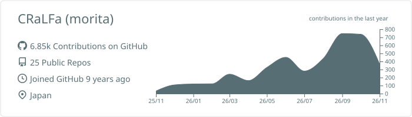
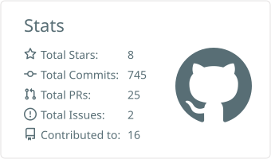
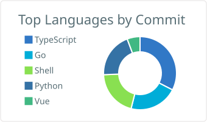
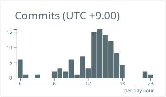

### Hey👋, I'm CRaLFa

I love [Go](https://go.dev/), [TypeScript](https://www.typescriptlang.org/) and [Vim](https://www.vim.org/).

- Software engineer in Japan
- Building bots (Discord / Slack / LINE) and small web apps
- Vim plugin author (vim9-img-search)
- WSL2 & PowerShell user

## <picture><source media="(prefers-color-scheme: dark)" srcset="icons/person-24-dark.svg" /></picture> Status

<a href="https://github.com/vn7n24fzkq/github-profile-summary-cards"><picture><source media="(prefers-color-scheme: dark)" srcset="profile-summary-card-output/github_dark/0-profile-details.svg" /></picture></a>
<a href="https://github.com/vn7n24fzkq/github-profile-summary-cards"><picture><source media="(prefers-color-scheme: dark)" srcset="profile-summary-card-output/github_dark/3-stats.svg" /></picture></a>
<a href="https://github.com/vn7n24fzkq/github-profile-summary-cards"><picture><source media="(prefers-color-scheme: dark)" srcset="profile-summary-card-output/github_dark/2-most-commit-language.svg" /></picture></a>
<a href="https://github.com/vn7n24fzkq/github-profile-summary-cards"><picture><source media="(prefers-color-scheme: dark)" srcset="profile-summary-card-output/github_dark/4-productive-time.svg" /></picture></a>

<picture><source media="(prefers-color-scheme: dark)" srcset="https://github-readme-activity-graph.vercel.app/graph?username=CRaLFa&hide_border=true&area=true&bg_color=0D1117&color=C9D1D9&line=00ADD8&point=58A6FF&title_color=00ADD8&area_color=00ADD8" /></picture>

### Language

### Editor

### OS

### Frameworks

### Infrastructure

### Dev tools

